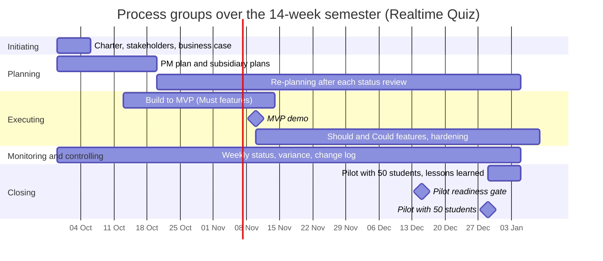

# Process groups over the semester

The five process groups are not strictly sequential phases. They overlap and recur: planning is updated as the team learns, while monitoring and controlling continues throughout the semester.

| Process group | Weeks active | Main activities | Outputs | Lab that produces them |
|---|---|---|---|---|
| Initiating | 1 | Confirm need, identify sponsor and PM, define high-level objectives and stakeholders | Charter, initial stakeholder list, business case | Lab-01 |
| Planning | 1-3, then updated in weeks 4-14 | Define scope, schedule, budget, quality, communications, risks and procurement; re-plan after reviews and approved changes | Project management plan, subsidiary plans, baselines and updates | Lab-01; detailed plans in later labs |
| Executing | 3-14 | Build Must features, integrate and test, deliver Should features if time permits, prepare deployment and training | Working increments, demos, test evidence, deployment package and runbook | Later implementation labs |
| Monitoring and controlling | 1-14 | Weekly status, schedule/cost variance, quality and risk reviews, change requests and corrective action | Status reports, risk and issue logs, change log, updated forecasts and baselines | Every lab; tools and controls in later labs |
| Closing | 14 | Run pilot, obtain acceptance, hand over operations, document lessons learned and close remaining work | Pilot report, acceptance/handover record, lessons learned and closure summary | Lab-01 charter gate and final lab records |

## Mermaid Gantt

## Phase gates

1. **Week 1 — authorise or stop:** The Head of the IT department signs the charter and confirms the 490-hour effort plan, USD 200 cash cap, named PM, Must scope and measurable objectives. Without an accountable sponsor and approved charter, the team should not baseline delivery.
2. **Week 7 — continue, change or switch:** The sponsor reviews a live MVP demonstration against every Must-feature criterion, the defect list, CI status, forecast and risks. If the MVP fails or has unresolved blocking defects, the sponsor considers the SaaS fallback.
3. **Week 13 — pilot readiness:** The sponsor reviews the load-test report for 100 simulated students, the 500 ms p95 broadcast target, timer-drift evidence, at least 80% line coverage, accessibility checks, data-protection approval, deployment checklist and operations runbook. The pilot proceeds only if critical conditions are met.

Each gate tests continued business justification: expected teaching benefit, acceptable risk, remaining time and cost, and evidence that the next stage remains worthwhile.
